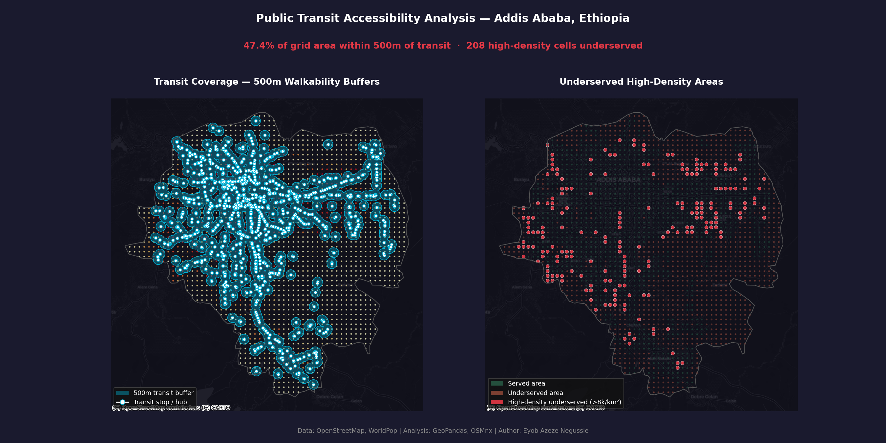

# 🚌 Transit Access & Underserved Areas — Addis Ababa

**A spatial equity analysis of public transit accessibility in Addis Ababa, Ethiopia**
> *Who has access to public transport — and who is being left behind?*

---

## Overview

This project applies spatial analysis techniques to evaluate public transit accessibility across Addis Ababa. Using OpenStreetMap transit data and real population data from WorldPop, it identifies neighborhoods that are densely populated yet poorly served by the city's bus and light rail network.

The analysis is motivated by a simple question: as Addis Ababa continues to grow rapidly, are transit investments reaching the people who need them most?

---

## Key Findings

| Metric                              | Value                                    |
| ------------------------------------ | ----------------------------------------- |
| Transit stops analyzed              | 2,417 (bus, light rail, minibus taxi)     |
| Walkability buffer radius           | 500m (standard pedestrian shed)           |
| City area within transit reach      | 254.3 km² (47.4% of the study area)       |
| High-density underserved grid cells | 208                                       |
| Population grid resolution          | 2,147 cells, real WorldPop-derived data   |

Real population data (not an estimate) shows that **over half the city's area falls outside a comfortable 500-meter walk of any transit stop** — and 208 of those underserved grid cells are in high-density zones, representing the areas where a coverage gap affects the most people.

---

## Maps

### Static Analysis Map



*Left: 500m walkability buffers around transit stops overlaid on real population density. Right: served vs. underserved areas, with high-density underserved zones highlighted in red.*

### Interactive Web Map

Open `outputs/transit_access_interactive.html` in any browser to explore:
- Individual transit stop locations with popup labels
- 500m walkability buffer zones
- High-density underserved areas

---

## Tools & Methods

| Tool           | Purpose                                                   |
| -------------- | ---------------------------------------------------------- |
| **GeoPandas**  | Spatial data manipulation, buffer analysis, spatial joins  |
| **OSMnx**      | Fetching transit infrastructure from OpenStreetMap         |
| **Rasterio**   | Reading and reprojecting WorldPop population raster data   |
| **Folium**     | Interactive web map generation                             |
| **Contextily** | Basemap tiles for static maps                              |
| **Matplotlib** | Static publication-quality maps                            |
| **Shapely**    | Geometric operations (buffers, unions)                     |

**Coordinate Reference System:** EPSG:32637 (UTM Zone 37N) for accurate metric measurements in Ethiopia.

---

## Data Sources

| Dataset                        | Source                                                                                    | Notes                                              |
| ------------------------------- | -------------------------------------------------------------------------------------------| --------------------------------------------------- |
| Transit stops & infrastructure  | [OpenStreetMap](https://www.openstreetmap.org/) via OSMnx                                  | Bus stops, light rail stations                     |
| Population density              | [WorldPop](https://www.worldpop.org/) via [HDX](https://data.humdata.org/dataset/worldpop-population-counts-2015-2030-eth) | Constrained model, ~100m resolution, resampled to a 500m grid |
| Administrative boundaries       | [OCHA HDX Ethiopia](https://data.humdata.org/dataset/ethiopia-administrative-boundaries)    | City boundary, sub-city/woreda boundaries          |

---

## How to Run

```bash
# 1. Clone the repository
git clone https://github.com/eyobazeze/urban-analytics-projects.git
cd urban-analytics-projects

# 2. Create and activate the environment
conda env create -f environment.yml
conda activate urban-analytics

# 3. Download population data
# Get the Ethiopia population GeoTIFF from:
# https://data.humdata.org/dataset/worldpop-population-counts-2015-2030-eth
# Place it in data/raw/ before running the script

# 4. Run the analysis
python transit_access_analysis.py

# 5. View outputs
open outputs/transit_access_map.png
open outputs/transit_access_interactive.html
```

---

## Project Context

This project is part of a broader portfolio exploring smart city and urban data challenges in Ethiopian cities, and is the first of a two-part spatial analysis series.

**Related:**
- [Network-Based Healthcare & School Accessibility](https://github.com/eyobazeze/network-accessibility-project) — a companion project applying network analysis (real street-based walking distance) to a related accessibility question, reusing this project's population grid
- [Smart Public Transport App — Figma Case Study](https://eyobazeze.medium.com)

---

## Author

**Eyob Azeze** — UI/UX Designer | Urban Tech & Smart Cities | Addis Ababa, Ethiopia

[GitHub](https://github.com/eyobazeze) · [LinkedIn](https://linkedin.com/in/eyobazeze) · [Medium](https://eyobazeze.medium.com) · [Figma](https://figma.com/@eyobazeze) · [X / Twitter](https://x.com/EyobAzeze)
